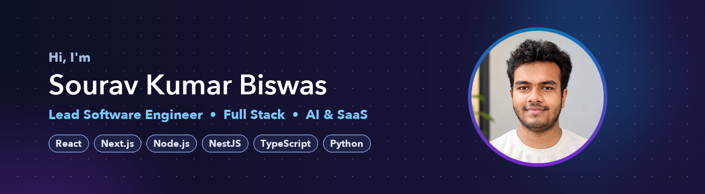

  
  
  

## About Me

Full Stack Developer from **Dhaka, Bangladesh**, specializing in **JavaScript and TypeScript**. I build scalable web applications, REST APIs, AI integrations and SaaS platforms, with a strong focus on reliable production systems.

- 💼 **Lead Software Engineer** at **OrbaAise Technologies** (Florida, USA) — since June 2023
- 🤖 Building AI-powered SaaS & business automation platforms (CRM, support, e-commerce, finance)
- ⚡ Real-time features with Socket.io, AI chatbots and live tracking
- 👥 Leading a 10-person development team
- 🎓 B.Sc. in CSE (University of Dhaka) · M.Sc. in IT (Jahangirnagar University, ongoing)

## Tech Stack

  

## GitHub Stats

<!-- CONTRIB:START -->

  

<!-- CONTRIB:END -->

